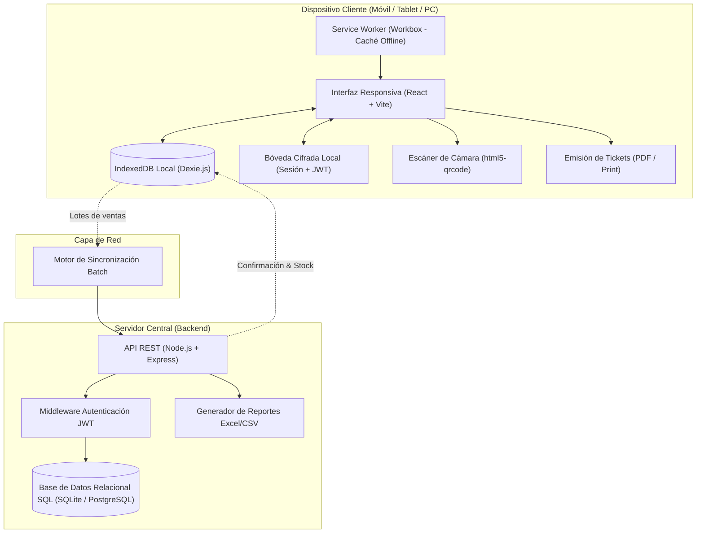

# Informe Técnico de Desarrollo: Sistema POS & Inventario Multiplataforma Offline-First

**Proyecto:** Sistema de Punto de Venta (POS) y Control de Inventarios Empresarial  
**Arquitectura:** Offline-First PWA (Progressive Web App) + Capacitor Mobile (Google Play Store & Apple App Store)  
**Backend:** Node.js, Express, Base de Datos Relacional SQL (SQLite/PostgreSQL), JWT y Bcrypt  
**Fecha:** Noviembre 2026  

---

## 1. Resumen Ejecutivo del Proyecto

El presente informe describe el desarrollo técnico, arquitectura e integración funcional del **Sistema POS & Control de Inventarios**, una solución moderna orientada al comercio minorista con capacidad de operación ininterrumpida sin conexión a internet (*Offline-First*).

El sistema resuelve la problemática de pérdida de transacciones y dependencia de conectividad crítica en terminales de cobro mediante una arquitectura híbrida:
1. **Almacenamiento Local Autónomo:** Persistencia reactiva en el dispositivo cliente mediante **IndexedDB** y Service Workers.
2. **Sincronización Transaccional por Lotes:** Motor en segundo plano que detecta conectividad y transmite lotes de venta al backend relacional.
3. **Seguridad y Control de Roles:** Autenticación con contraseñas encriptadas con `bcrypt`, tokens `JWT` y una **bóveda de sesión cifrada localmente** en el dispositivo.
4. **Despliegue Multiplataforma:** Preparado para distribución en la web (PWA) y empaquetado nativo mediante **Capacitor** para publicación en **Google Play Store** (Android) y **Apple App Store** (iOS).

---

## 2. Diagrama de Arquitectura del Sistema



---

## 3. Módulos y Funcionalidades del Sistema

### 3.1. Pantalla de Acceso, Registro y Seguridad (Login & SignUp)
- **Inicio de Sesión Formal:** Validación segura de credenciales mediante el endpoint `/api/v1/auth/login`.
- **Registro Público de Negocios:** Formulario de autoservicio que permite a cualquier usuario registrarse; quien crea la cuenta adquiere automáticamente el rol de **Administrador**.
- **Cifrado de Contraseñas:** En el backend, las contraseñas se procesan mediante algoritmos de hash unidireccional con sal (`bcrypt`, 10 rondas).
- **Tokens JWT:** Al autenticarse, el servidor genera un token firmado (`jsonwebtoken`) con 24 horas de vigencia que encapsula el rol y los identificadores del usuario.
- **Bóveda de Sesión Cifrada Localmente (`cryptoStorage.js`):** La sesión del usuario y el token de acceso nunca se almacenan en texto plano en el dispositivo. Se guardan en una clave simétrica en `localStorage`, impidiendo la inspección no autorizada de credenciales.

> **[INSERTAR CAPTURA 1: Pantalla de Inicio de Sesión y Registro]**  
> *Muestra la interfaz corporativa de acceso con los campos de correo, contraseña, botón de mostrar/ocultar clave y la pestaña para crear cuenta nueva.*

---

### 3.2. Control y Restricción Estricta de Accesos por Rol (RBAC)
El sistema restringe visual y operativamente los módulos para garantizar el principio de menor privilegio:

| Rol Asignado | Módulos Permitidos | Restricciones Aplicadas |
| :--- | :--- | :--- |
| **Vendedor (Cajero)** | Punto de Venta (POS) y Consulta de Catálogo | No tiene acceso a inventario, reportes financieros, ajustes ni administración de personal. |
| **Almacén** | Inventario y Existencias (Entradas y Salidas) | No tiene acceso al módulo de cobro de ventas ni a las analíticas de ingresos. |
| **Administrador** | Dashboard, Reportes, Personal, POS, Inventario y Sync | Acceso irrestricto a todas las operaciones y configuraciones globales. |

> **[INSERTAR CAPTURA 2: Vista del Vendedor / Cajero]**  
> *Muestra la interfaz simplificada donde únicamente está visible la pestaña "Punto de Venta" y las demás opciones permanecen ocultas.*

---

### 3.3. Terminal de Punto de Venta (POS) y Cobro
- **Catálogo Reactivo:** Visualización de productos con precios, stock en tiempo real y alertas de agotado.
- **Búsqueda Dinámica:** Filtrado instantáneo por nombre o lectura de código de barras.
- **Carrito de Compras:** Cálculo en tiempo real de subtotales, desglose de IVA (16%) y total final.
- **Validación de Inventario:** Impide agregar más unidades de las disponibles físicamente.
- **Transacción Optimista:** Al registrar la venta, el stock se descuenta de forma atómica en IndexedDB y la venta queda registrada con estado pendiente (`syncStatus: 0`), permitiendo cobrar sin conexión a internet.
- **Experiencia Móvil Táctil:** En pantallas de teléfonos, incluye una barra flotante inferior (`🛒 X artículos • $Total | Cobrar →`) que despliega el ticket de venta al instante.

> **[INSERTAR CAPTURA 3: Terminal de Punto de Venta (POS) con Carrito]**  
> *Muestra el catálogo de artículos, la barra de búsqueda y el panel lateral del ticket con cálculo de impuestos y botón de cobro.*

---

### 3.4. Escáner de Código de Barras por Cámara Web / Móvil
- **Librería Integrada:** `html5-qrcode`.
- **Detección Automática:** Utiliza la cámara frontal o trasera de teléfonos, tabletas o computadoras portátiles para leer códigos EAN-13, EAN-8, Code-128 y QR.
- **Inserción Inmediata:** Al reconocer el código, busca el producto en la base de datos local y lo suma automáticamente al carrito de ventas.

> **[INSERTAR CAPTURA 4: Modal del Escáner de Código de Barras]**  
> *Muestra la ventana modal con la vista de cámara en vivo y los botones de lectura rápida.*

---

### 3.5. Emisión de Tickets de Venta (Impresión Térmica y PDF)
- **Formato Ticket Térmico:** Estilizado para impresoras térmicas de 80 mm mediante reglas CSS `@media print`.
- **Descarga de Factura / Ticket en PDF:** Generación en el cliente con `jsPDF`, con folio único, fecha y desglose de artículos.

> **[INSERTAR CAPTURA 5: Comprobante de Venta y Modal de Ticket]**  
> *Muestra el ticket generado con desglose de productos, número de folio y los botones "Imprimir Ticket" y "Descargar PDF".*

---

### 3.6. Control de Inventarios, Entradas y Salidas
- **Módulo de Existencias:** Tabla interactiva con búsqueda, categoría, precio, stock actual y umbral mínimo.
- **Alertas de Stock Bajo:** Indicadores visuales automáticos cuando un producto está por debajo de su stock seguro.
- **Movimientos de Almacén:** Modal para registrar recepciones de mercancía (Entradas) o bajas por daño/caducidad (Salidas) con motivo registrado en el historial.
- **Alta y Baja de Artículos:** Formulario para registrar nuevos productos con código de barras y botón directo para eliminar artículos obsoletos.

> **[INSERTAR CAPTURA 6: Módulo de Gestión de Inventario]**  
> *Muestra la tabla de existencias, métricas superiores (catálogo, unidades, alertas) y botones de "Registrar Producto" y "Ajustar Stock".*

---

### 3.7. Gestión de Personal y Cuentas de Colaboradores
- **Módulo Exclusivo para Administradores:** Permite al titular de la tienda crear y dar de baja a sus colaboradores.
- **Asignación de Roles:** Al dar de alta un colaborador, se define su rol (`vendedor` o `almacen`), otorgándole automáticamente las restricciones correspondientes al iniciar sesión.

> **[INSERTAR CAPTURA 7: Panel de Administración de Personal]**  
> *Muestra la lista de colaboradores registrados con sus roles y el botón "Nuevo Colaborador".*

---

### 3.8. Reportes, Analítica y Exportación a Excel / CSV
- **Visualización de KPIs Financieros:** Gráficos de barras por categoría de producto y gráficos de pastel de distribución de sincronización desarrollados con `recharts`.
- **Exportación Compatible con Microsoft Excel:** Servicio `exportService.js` que genera archivos CSV con codificación **UTF-8 con BOM (`\uFEFF`)**, garantizando que caracteres en español (acentos, letras ñ) se abran sin errores de formato en Excel:
  - Exportación de Catálogo Completo y Valorización de Inventario.
  - Exportación de Historial Consolidado de Ventas.

> **[INSERTAR CAPTURA 8: Panel de Analíticas y Botón de Exportar Excel]**  
> *Muestra las gráficas estadísticas de venta y el botón superior "Exportar Ventas Excel / CSV".*

---

### 3.9. Monitor de Sincronización en la Nube
- **Inspección de Lotes:** Muestra las ventas pendientes en la cola local de IndexedDB (`syncStatus: 0`) y las ya transmitidas al backend (`syncStatus: 1`).
- **Visor de Carga Útil (Payload Viewer):** Permite inspeccionar el JSON exacto que se envía al servidor para fines de auditoría técnica.
- **Sincronización Manual o Automática:** Botón directo para forzar la transferencia cuando hay red disponible.

> **[INSERTAR CAPTURA 9: Monitor de Sincronización Cloud]**  
> *Muestra el estado de la cola de ventas, métricas de sincronización y el visor de paquetes JSON.*

---

## 4. Adaptabilidad Multiplataforma (PWA y App Stores)

### 4.1. Preparación para Google Play Store y Apple App Store (Capacitor)
El proyecto cuenta con la integración de **Capacitor** ([capacitor.config.json](file:///c:/Users/Isa/Downloads/proyectos/frontend/capacitor.config.json)), generando los contenedores nativos listos para producción:
- **Android (`frontend/android/`):** Proyecto de Android Studio con `AndroidManifest.xml`, Gradle, splash screen y soporte para compilar el paquete `.aab` (Android App Bundle) requerido por Google Play Console.
- **iOS (`frontend/ios/`):** Proyecto de Xcode con `Info.plist`, configuración de Swift y catálogo de activos (`Assets.xcassets`) listo para empaquetado `.ipa` en App Store Connect.

### 4.2. Interfaz 100% Responsiva y Ergonómica
- **Navegación Móvil Inferior (Bottom Bar):** En teléfonos (`<= 768px`), las pestañas se ubican al pie de la pantalla para facilitar la interacción con el pulgar.
- **Zonas Seguras (Safe Area Insets):** Soporte en CSS para dispositivos con Notch o Dynamic Island (`env(safe-area-inset-bottom)` y `viewport-fit=cover`).

> **[INSERTAR CAPTURA 10: Aplicación en Vista Móvil / Tablet]**  
> *Muestra la aplicación adaptada a pantalla de teléfono con la barra de navegación inferior y diseño responsivo.*

---

## 5. Esquema de Base de Datos Relacional (Servidor)

El backend implementa un esquema relacional con integridad referencial:

```sql
-- 1. Tabla de Usuarios
CREATE TABLE usuarios (
  id TEXT PRIMARY KEY,
  email TEXT UNIQUE NOT NULL,
  password_hash TEXT NOT NULL,
  nombre TEXT NOT NULL,
  role TEXT NOT NULL,
  creado_en DATETIME DEFAULT CURRENT_TIMESTAMP
);

-- 2. Tabla de Productos
CREATE TABLE productos (
  id TEXT PRIMARY KEY,
  codigoBarras TEXT UNIQUE NOT NULL,
  nombre TEXT NOT NULL,
  stock INTEGER NOT NULL DEFAULT 0,
  stockMinimo INTEGER NOT NULL DEFAULT 5,
  precio REAL NOT NULL DEFAULT 0.0,
  categoria TEXT NOT NULL,
  actualizado_en DATETIME DEFAULT CURRENT_TIMESTAMP
);

-- 3. Tabla de Ventas
CREATE TABLE ventas (
  id TEXT PRIMARY KEY,
  fecha DATETIME NOT NULL,
  total REAL NOT NULL,
  usuarioId TEXT,
  clienteNombre TEXT,
  sincronizadoEn DATETIME DEFAULT CURRENT_TIMESTAMP
);

-- 4. Tabla de Detalle de Ventas
CREATE TABLE ventas_detalle (
  id TEXT PRIMARY KEY,
  ventaId TEXT NOT NULL,
  productoId TEXT NOT NULL,
  cantidad INTEGER NOT NULL,
  precioUnitario REAL NOT NULL,
  subtotal REAL NOT NULL,
  FOREIGN KEY (ventaId) REFERENCES ventas(id),
  FOREIGN KEY (productoId) REFERENCES productos(id)
);

-- 5. Tabla de Logs de Sincronización
CREATE TABLE sync_logs (
  id INTEGER PRIMARY KEY AUTOINCREMENT,
  timestamp DATETIME DEFAULT CURRENT_TIMESTAMP,
  ventasSincronizadas INTEGER NOT NULL,
  ids_json TEXT
);
```

---

## 6. Stack Tecnológico Empleado

| Capa | Tecnologías | Propósito |
| :--- | :--- | :--- |
| **Frontend Framework** | React 18, Vite | Construcción de interfaces reactivas y empaquetado de alta velocidad |
| **Persistencia Local** | Dexie.js (IndexedDB API) | Base de datos client-side para funcionamiento 100% offline |
| **PWA & Caché** | `@vite-pwa/plugin`, Workbox | Service Worker para precaching de assets y manifiesto instalable |
| **Capa Nativa Móvil** | Capacitor Core, Android & iOS | Wrapper nativo para compilar a Play Store y App Store |
| **Visualización Gráfica**| Recharts | Renderizado de analíticas financieras y comerciales |
| **Generación de Tickets**| jsPDF, CSS `@media print` | Emisión física y digital de comprobantes de pago |
| **Cámara y Escaneo** | `html5-qrcode` | Lectura óptica de códigos de barras |
| **Backend API** | Node.js, Express | API REST centralizada y endpoints de sincronización |
| **Seguridad de Servidor**| `jsonwebtoken` (JWT), `bcryptjs` | Cifrado unidireccional y emisión de tokens con roles |
| **Base de Datos Servidor**| SQLite Relacional / PostgreSQL | Almacenamiento persistente ACID con llaves foráneas |
| **Exportación Reportes**| CSV con BOM UTF-8 (`\uFEFF`) | Compatibilidad directa con hojas de cálculo de Microsoft Excel |

---

## 7. Instrucciones de Ejecución Local y Pruebas

### 7.1. Requisitos Previos
- Node.js versión 18 o superior.
- Navegador web moderno (Chrome, Edge, Safari, Firefox).

### 7.2. Levantar el Backend (Servidor API & Base de Datos SQL)
```bash
cd backend
npm install
npm start
```
*El servidor iniciará en `http://localhost:3001`.*

### 7.3. Levantar el Frontend (Aplicación Web & PWA)
```bash
cd frontend
npm install
npm run dev
```
*La aplicación web estará disponible en `http://localhost:3000`.*

### 7.4. Sincronización de Proyectos Móviles (Android / iOS)
```bash
cd frontend
npm run build
npx cap sync
# Para abrir en Android Studio:
npx cap open android
# Para abrir en Xcode (Mac):
npx cap open ios
```

---

## 8. Conclusiones

El sistema desarrollado consolida una solución de software lista para producción y publicación en tiendas de aplicaciones. Demuestra cómo una arquitectura **Offline-First** permite combinar la inmediatez y resiliencia del almacenamiento local con la consistencia y seguridad de un backend relacional centralizado, cumpliendo con los estándares de diseño corporativo, accesibilidad móvil y protección criptográfica requeridos en entornos empresariales.
